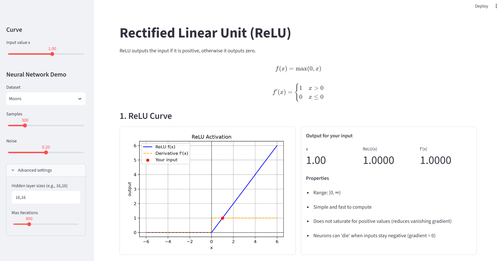
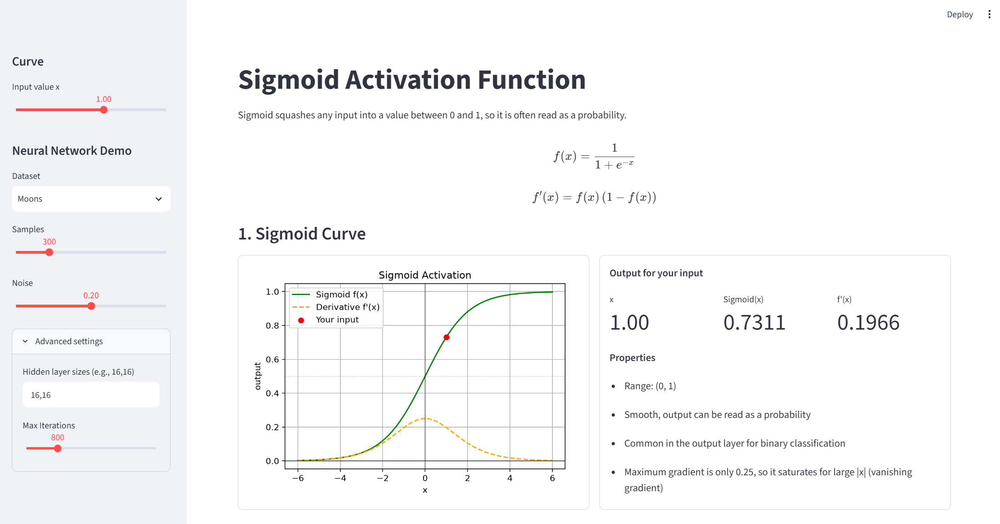
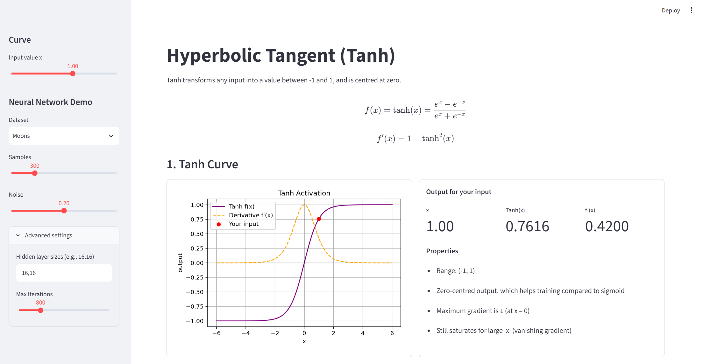

# Activation Function Visualiser (ReLU, Sigmoid, Tanh)

**BSD3513 Introduction to Artificial Intelligence – Lab Report 4**

MOK KER QIN | SD24032

This repository has three separate Streamlit web apps. Each one visualises a neural network activation function:

1. **Rectified Linear Unit (ReLU)**: `relu_app.py`
2. **Sigmoid**: `sigmoid_app.py`
3. **Hyperbolic Tangent (Tanh)**: `tanh_app.py`

## Live Apps

| App | Live link |
|---|---|
| ReLU | [ailabreport4-relu.streamlit.app](https://ailabreport4-relu.streamlit.app/) |
| Sigmoid | [ailabreport4-sigmoid.streamlit.app](https://ailabreport4-sigmoid.streamlit.app/) |
| Tanh | [ailabreport4-tanh.streamlit.app](https://ailabreport4-tanh.streamlit.app/) |

## Features

Each app has the same layout so the three functions are easy to compare.

- **Formula:** the activation function f(x) and its derivative f'(x).
- **1. Curve:** a graph of f(x) and f'(x) from -6 to 6. Use the *Input value x* slider to pick a point. The app marks it on the graph and shows f(x) and f'(x) in the output box, with the function's key properties.
- **2. Neural Network:** a small multilayer perceptron (MLP) trained with that activation function on a non-linear toy dataset (Moons or Circles). It shows the decision boundary and the accuracy.

### Sidebar settings

| Setting | Description |
|---|---|
| Input value x | Value passed into the activation function |
| Dataset | Moons or Circles (both are non-linear) |
| Samples | Number of data points (100 to 1000) |
| Noise | Amount of noise in the data (0.00 to 0.40) |
| Advanced settings | Hidden layer sizes (e.g. `16,16`) and maximum iterations |

The random seed is fixed at 42 so results are reproducible.

## Screenshots

### ReLU
Live app: https://ailabreport4-relu.streamlit.app/



### Sigmoid
Live app: https://ailabreport4-sigmoid.streamlit.app/



### Tanh
Live app: https://ailabreport4-tanh.streamlit.app/



## Activation Functions Summary

| Function | Formula | Derivative | Range |
|---|---|---|---|
| ReLU | max(0, x) | 1 if x > 0, else 0 | [0, ∞) |
| Sigmoid | 1 / (1 + e^-x) | f(x)(1 - f(x)) | (0, 1) |
| Tanh | (e^x - e^-x) / (e^x + e^-x) | 1 - tanh²(x) | (-1, 1) |

With the default settings (Moons, 300 samples, noise 0.20), the MLP reached these accuracies:

| Activation | Accuracy |
|---|---|
| ReLU | 0.970 |
| Sigmoid | 0.877 |
| Tanh | 0.977 |

Sigmoid scores lowest because its gradient is at most 0.25, so the network learns more slowly (the vanishing gradient problem).

---

## Run locally
1. Download this repo (green **Code** button → **Download ZIP**) and unzip it.
2. Open a terminal in the folder and run:
```bash
pip install -r requirements.txt
```
3. Start the app you want to see:
```bash
streamlit run relu_app.py
streamlit run sigmoid_app.py
streamlit run tanh_app.py
```
4. The app opens in your browser at `http://localhost:8501`. 

---

## Repository Structure

```
├── relu_app.py          # ReLU app
├── sigmoid_app.py       # Sigmoid app
├── tanh_app.py          # Tanh app
├── requirements.txt     # Python packages
├── screenshots/         # App screenshots used in this README
└── README.md
```

## Tools Used

- Python
- Streamlit (web app)
- NumPy (calculations)
- Matplotlib (graphs)
- scikit-learn (datasets and MLPClassifier)
